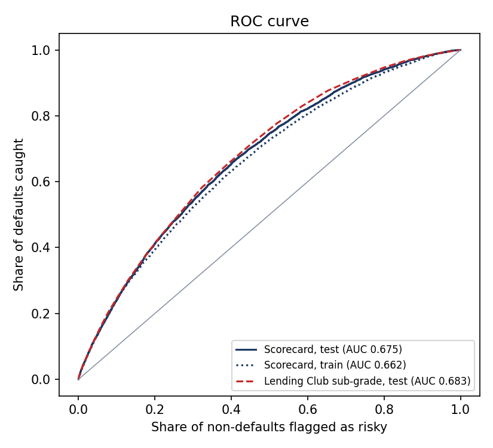
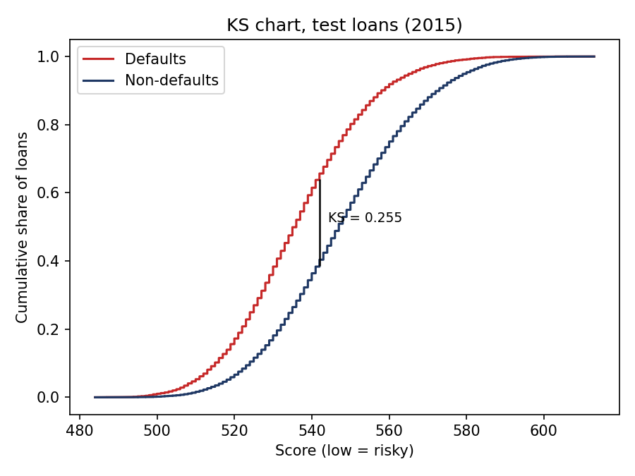
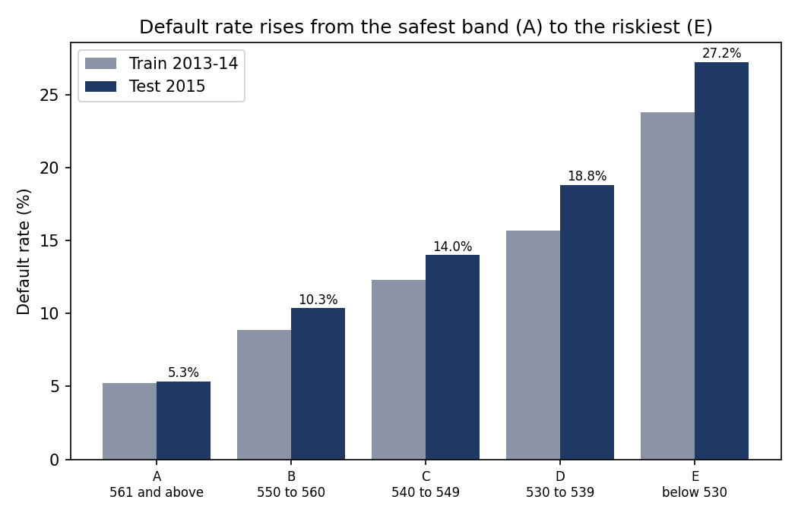
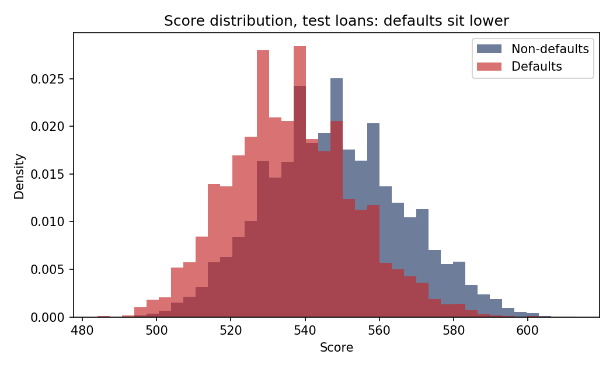

# Credit scorecard

Written by `src/scorecard_model.py`. Logistic regression on weight-of-evidence features, fitted on loans issued 2013-2014 and tested on loans issued 2015. Higher score = safer borrower. Definitions: M52 (AUC), M53 (Gini), M54 (KS), M55 (default rate by band) in `docs/metric_dictionary.md`.

## 1. Model quality

| Model / data | Loans | Default rate | AUC | Gini | KS |
|---|---|---|---|---|---|
| Scorecard, train | 120,000 | 12.96% | 0.662 | 0.325 | 0.234 |
| Scorecard, test | 60,000 | 14.83% | 0.675 | 0.350 | 0.256 |
| Lending Club sub_grade (benchmark), test | 60,000 | 14.83% | 0.683 | 0.365 | 0.263 |
| Lending Club int_rate (benchmark), test | 60,000 | 14.83% | 0.682 | 0.364 | 0.263 |
| FICO score alone (benchmark), test | 60,000 | 14.83% | 0.602 | 0.204 | 0.155 |

AUC is the chance a random defaulter is ranked riskier than a random non-defaulter (0.5 = no skill). Gini = 2 x AUC - 1. KS is the largest gap between the cumulative shares of defaults and non-defaults.
The benchmark rows show how Lending Club's own sub-grade, which uses extra information we deliberately leave out, ranks the same loans.

## 2. Calibration across time

| Loans | Actual default rate | Average predicted default rate |
|---|---|---|
| Train (2013-2014) | 12.96% | 12.96% |
| Test (2015) | 14.83% | 12.97% |

The scorecard ranks borrowers; it does not know that later loan years default more often. When the test row shows actual above predicted, the PD should be read as a relative ranking, or recalibrated on recent data before it is used as an absolute probability.

## 3. Risk bands

Bands are cut at the 20th, 40th, 60th and 80th percentile of the train scores and applied unchanged to the test loans.

**Test loans**

| Band | Score range | Loans | Share | Defaults | Default rate | Lift vs average |
|---|---|---|---|---|---|---|
| A | 561 and above | 13,463 | 22.4% | 720 | 5.3% | 0.36x |
| B | 550 to 560 | 11,431 | 19.1% | 1,183 | 10.3% | 0.70x |
| C | 540 to 549 | 12,275 | 20.5% | 1,718 | 14.0% | 0.94x |
| D | 530 to 539 | 11,097 | 18.5% | 2,085 | 18.8% | 1.27x |
| E | below 530 | 11,734 | 19.6% | 3,193 | 27.2% | 1.83x |

Default rate rises steadily from A to E: **yes**.

**Train loans**

| Band | Score range | Loans | Share | Defaults | Default rate | Lift vs average |
|---|---|---|---|---|---|---|
| A | 561 and above | 25,182 | 21.0% | 1,313 | 5.2% | 0.40x |
| B | 550 to 560 | 23,216 | 19.3% | 2,063 | 8.9% | 0.69x |
| C | 540 to 549 | 25,890 | 21.6% | 3,184 | 12.3% | 0.95x |
| D | 530 to 539 | 23,149 | 19.3% | 3,629 | 15.7% | 1.21x |
| E | below 530 | 22,563 | 18.8% | 5,363 | 23.8% | 1.83x |

Default rate rises steadily from A to E: **yes**.

## 4. Model features and coefficients

14 features in the final model. Every coefficient is negative: a higher WoE (safer bin) lowers the chance of default.

| Feature | IV | Coefficient | Std. error | p-value |
|---|---|---|---|---|
| `acc_open_past_24mths` | 0.0588 | -1.016 | 0.040 | 0.0000 |
| `inq_last_6mths` | 0.0271 | -0.888 | 0.055 | 0.0000 |
| `loan_to_income` | 0.0421 | -0.819 | 0.048 | 0.0000 |
| `fico_avg` | 0.1260 | -0.569 | 0.032 | 0.0000 |
| `emp_length` | 0.0206 | -0.559 | 0.061 | 0.0000 |
| `dti` | 0.0540 | -0.519 | 0.042 | 0.0000 |
| `percent_bc_gt_75` | 0.0351 | -0.451 | 0.063 | 0.0000 |
| `total_rev_hi_lim` | 0.0612 | -0.408 | 0.048 | 0.0000 |
| `home_ownership` | 0.0411 | -0.320 | 0.059 | 0.0000 |
| `annual_inc` | 0.0938 | -0.315 | 0.040 | 0.0000 |
| `revol_util` | 0.0206 | -0.292 | 0.091 | 0.0013 |
| `tot_cur_bal` | 0.0659 | -0.279 | 0.054 | 0.0000 |
| `mort_acc` | 0.0510 | -0.217 | 0.057 | 0.0001 |
| `credit_history_years` | 0.0238 | -0.162 | 0.062 | 0.0091 |
| intercept | | -1.907 | 0.009 | 0.0000 |

### Features removed while building the model

| Feature | Reason |
|---|---|
| `bc_util` | correlated +0.77 with `percent_bc_gt_75` (higher IV) |
| `revol_bal` | correlated +0.77 with `total_rev_hi_lim` (higher IV) |

## 5. Scaling

Score = 487.12 - 28.85 x (log-odds of default). 600 points at odds of 50 to 1 (non-default to default); every 20 points doubles the odds. Points per bin are in `docs/scorecard_points.csv`; the score of a loan is the sum of the points of the bin it falls in for each of the 14 features.

## 6. Points of the strongest features

**`fico_avg`**

| Bin | Range | WoE | Points |
|---|---|---|---|
| 1 | <= 662 | -0.390 | 32 |
| 2 | > 662 to 672 | -0.288 | 34 |
| 3 | > 672 to 682 | -0.197 | 35 |
| 4 | > 682 to 687 | -0.138 | 36 |
| 5 | > 687 to 697 | +0.031 | 39 |
| 6 | > 697 to 707 | +0.195 | 42 |
| 7 | > 707 to 717 | +0.311 | 44 |
| 8 | > 717 | +0.754 | 51 |

**`annual_inc`**

| Bin | Range | WoE | Points |
|---|---|---|---|
| 1 | <= 2.66e+04 | -0.521 | 34 |
| 2 | > 2.66e+04 to 3.6e+04 | -0.434 | 35 |
| 3 | > 3.6e+04 to 4e+04 | -0.226 | 37 |
| 4 | > 4e+04 to 5e+04 | -0.154 | 37 |
| 5 | > 5e+04 to 6.5e+04 | -0.001 | 39 |
| 6 | > 6.5e+04 to 8e+04 | +0.145 | 40 |
| 7 | > 8e+04 to 1.2e+05 | +0.397 | 42 |
| 8 | > 1.2e+05 | +0.466 | 43 |

**`tot_cur_bal`**

| Bin | Range | WoE | Points |
|---|---|---|---|
| 1 | <= 2.966e+04 | -0.210 | 37 |
| 2 | > 2.966e+04 to 5.123e+04 | -0.159 | 37 |
| 3 | > 5.123e+04 to 1.129e+05 | -0.073 | 38 |
| 4 | > 1.129e+05 to 1.405e+05 | -0.002 | 39 |
| 5 | > 1.405e+05 to 1.936e+05 | +0.120 | 40 |
| 6 | > 1.936e+05 to 2.255e+05 | +0.208 | 40 |
| 7 | > 2.255e+05 to 3.193e+05 | +0.423 | 42 |
| 8 | > 3.193e+05 | +0.592 | 43 |

**`total_rev_hi_lim`**

| Bin | Range | WoE | Points |
|---|---|---|---|
| 1 | <= 7800 | -0.273 | 36 |
| 2 | > 7800 to 1.42e+04 | -0.207 | 36 |
| 3 | > 1.42e+04 to 1.93e+04 | -0.118 | 37 |
| 4 | > 1.93e+04 to 2.59e+04 | -0.012 | 39 |
| 5 | > 2.59e+04 to 2.87e+04 | +0.038 | 39 |
| 6 | > 2.87e+04 to 4.08e+04 | +0.114 | 40 |
| 7 | > 4.08e+04 to 5.695e+04 | +0.317 | 42 |
| 8 | > 5.695e+04 | +0.621 | 46 |

