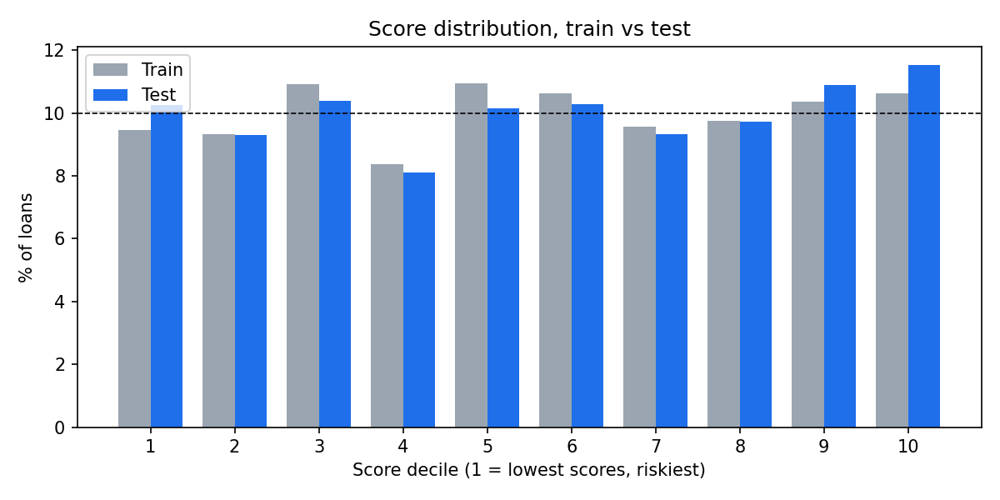
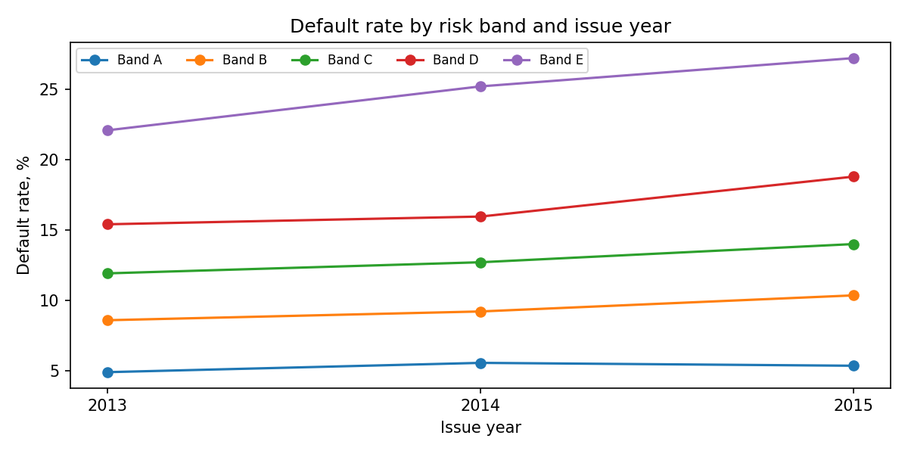
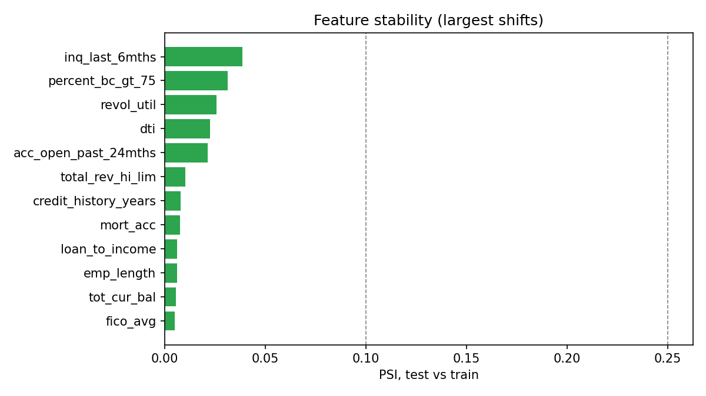

# Scorecard stability check (PSI)

Generated by `src/scorecard_stability.py`. Metric definition: M56 in `metric_dictionary.md`.

PSI compares how loans are spread across score ranges (or feature bins) in a later period with the train period. Under 0.10 = stable, 0.10 to 0.25 = moderate shift, over 0.25 = large shift. All bin edges come from the train data only.

## 1. Headline

- Score PSI, test vs train (10 train deciles): **0.003** (stable).
- Score PSI, test vs train (5 risk bands): **0.002** (stable).
- Features measured: 14; stable 14, moderate 0, large 0 (test vs train).
- Largest feature shift: `inq_last_6mths` at 0.039.
- Gini rose from 0.325 (train) to 0.350 (test); predicted default rate 12.97% vs actual 14.83% in the test year.

## 2. Score distribution (train deciles)

If the population were unchanged every cell would be about 10%.

| decile | train | test |
|---|---|---|
| 1 | 9.5% | 10.3% |
| 2 | 9.3% | 9.3% |
| 3 | 10.9% | 10.4% |
| 4 | 8.4% | 8.1% |
| 5 | 11.0% | 10.2% |
| 6 | 10.6% | 10.3% |
| 7 | 9.6% | 9.3% |
| 8 | 9.8% | 9.7% |
| 9 | 10.4% | 10.9% |
| 10 | 10.6% | 11.5% |

## 3. Performance and score PSI by issue year

| issue_year | data | loans | default_rate | avg_predicted_pd | AUC | Gini | KS | score_psi | score_status |
|---|---|---|---|---|---|---|---|---|---|
| 2013 | train | 60000 | 12.16% | 12.67% | 0.658 | 0.317 | 0.230 | 0.002 | stable |
| 2014 | train | 60000 | 13.76% | 13.25% | 0.665 | 0.330 | 0.237 | 0.002 | stable |
| 2015 | test | 60000 | 14.83% | 12.97% | 0.675 | 0.350 | 0.256 | 0.003 | stable |

## 4. Default rate by band and year

| issue_year | rate_A | rate_B | rate_C | rate_D | rate_E | band_psi | bands rise A to E |
|---|---|---|---|---|---|---|---|
| 2013 | 4.89% | 8.58% | 11.91% | 15.40% | 22.08% | 0.002 | yes |
| 2014 | 5.55% | 9.21% | 12.70% | 15.95% | 25.20% | 0.002 | yes |
| 2015 | 5.35% | 10.35% | 14.00% | 18.79% | 27.21% | 0.002 | yes |

## 5. Feature PSI against train

| feature | iv_train | 2013 | 2014 | 2015 | test | status (test) |
|---|---|---|---|---|---|---|
| inq_last_6mths | 0.027 | 0.000 | 0.000 | 0.039 | 0.039 | stable |
| percent_bc_gt_75 | 0.035 | 0.004 | 0.004 | 0.031 | 0.031 | stable |
| revol_util | 0.021 | 0.007 | 0.007 | 0.026 | 0.026 | stable |
| dti | 0.054 | 0.002 | 0.002 | 0.023 | 0.023 | stable |
| acc_open_past_24mths | 0.059 | 0.008 | 0.008 | 0.021 | 0.021 | stable |
| total_rev_hi_lim | 0.061 | 0.004 | 0.004 | 0.010 | 0.010 | stable |
| credit_history_years | 0.024 | 0.003 | 0.003 | 0.008 | 0.008 | stable |
| mort_acc | 0.051 | 0.000 | 0.000 | 0.008 | 0.008 | stable |
| loan_to_income | 0.042 | 0.003 | 0.003 | 0.006 | 0.006 | stable |
| emp_length | 0.021 | 0.002 | 0.002 | 0.006 | 0.006 | stable |
| tot_cur_bal | 0.066 | 0.001 | 0.001 | 0.006 | 0.006 | stable |
| fico_avg | 0.126 | 0.007 | 0.007 | 0.005 | 0.005 | stable |
| annual_inc | 0.094 | 0.001 | 0.001 | 0.004 | 0.004 | stable |
| home_ownership | 0.041 | 0.001 | 0.001 | 0.004 | 0.004 | stable |

## 6. How to read this

- A high score PSI says the borrower mix changed. It does not say the model is wrong: check the bands still rise from A to E (section 4) and the Gini (section 3).
- A high feature PSI points to what changed. If the shift is in a feature with a large IV, the model leans on it, so it matters more.
- The calibration gap (predicted vs actual default rate) is a separate issue from stability: the ranking can stay good while the level drifts. The usual remedy is to recalibrate the intercept on recent loans.
- Decision rule suggested for the board pack: PSI under 0.10 keep; 0.10 to 0.25 watch and re-check next quarter; over 0.25 investigate and consider refit.
