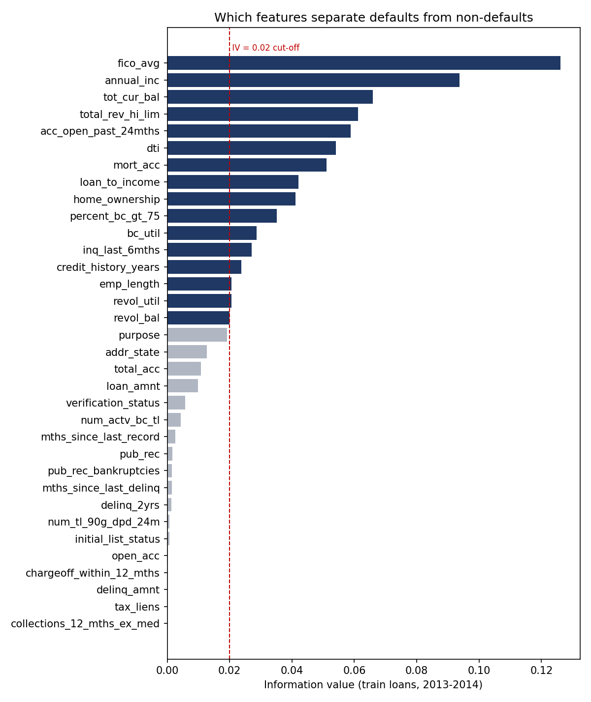
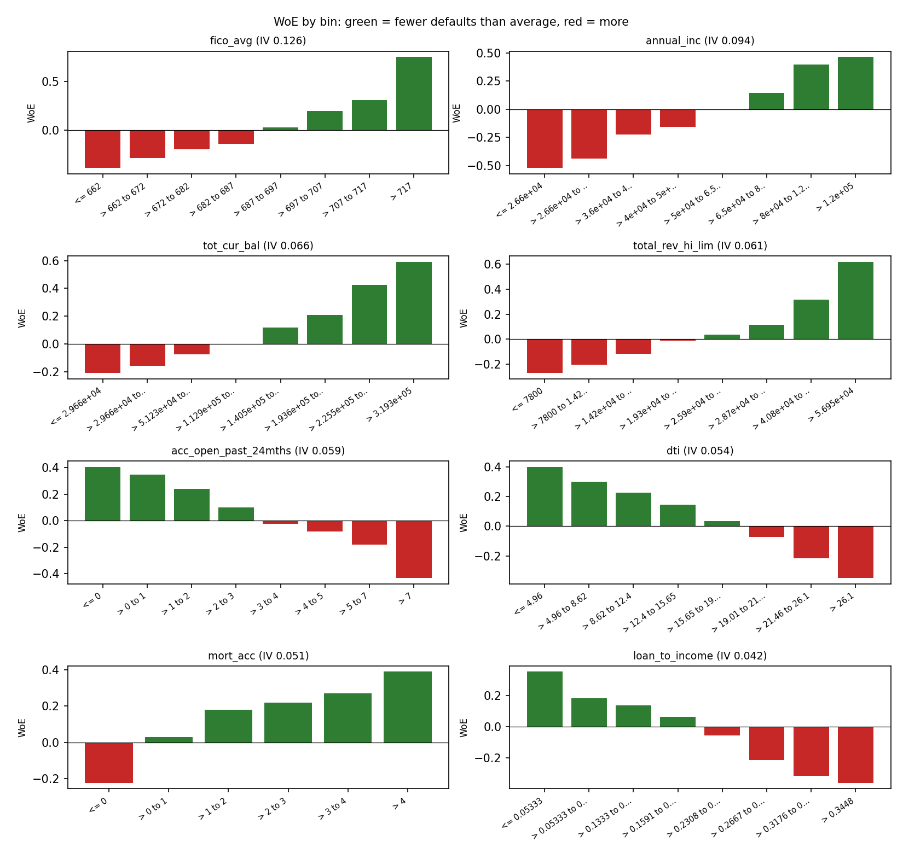

# WoE binning and information value

Written by `src/woe_binning.py`. Bins and WoE values were learned on the **train** loans (issue years 2013-2014, 120,000 loans) and applied unchanged to the **test** loans (2015, 60,000). Definitions: M50 (WoE) and M51 (IV) in `docs/metric_dictionary.md`. Every bin: `docs/woe_bins.csv`.

## 1. Feature ranking by information value

34 features were binned; **16 selected** (IV between 0.02 and 0.5).

| Rank | Feature | Type | Bins | IV train | IV test | Strength | Selected | Note |
|---|---|---|---|---|---|---|---|---|
| 1 | `fico_avg` | numeric | 8 | 0.1260 | 0.1460 | medium | yes |  |
| 2 | `annual_inc` | numeric | 8 | 0.0938 | 0.0601 | weak | yes |  |
| 3 | `tot_cur_bal` | numeric | 8 | 0.0659 | 0.0594 | weak | yes |  |
| 4 | `total_rev_hi_lim` | numeric | 8 | 0.0612 | 0.0601 | weak | yes |  |
| 5 | `acc_open_past_24mths` | numeric | 8 | 0.0588 | 0.1097 | weak | yes |  |
| 6 | `dti` | numeric | 8 | 0.0540 | 0.0673 | weak | yes |  |
| 7 | `mort_acc` | numeric | 6 | 0.0510 | 0.0502 | weak | yes |  |
| 8 | `loan_to_income` | numeric | 8 | 0.0421 | 0.0383 | weak | yes |  |
| 9 | `home_ownership` | categorical | 3 | 0.0411 | 0.0486 | weak | yes |  |
| 10 | `percent_bc_gt_75` | numeric | 6 | 0.0351 | 0.0282 | weak | yes |  |
| 11 | `bc_util` | numeric | 8 | 0.0287 | 0.0250 | weak | yes |  |
| 12 | `inq_last_6mths` | numeric | 4 | 0.0271 | 0.0600 | weak | yes |  |
| 13 | `credit_history_years` | numeric | 8 | 0.0238 | 0.0207 | weak | yes |  |
| 14 | `emp_length` | categorical | 8 | 0.0206 | 0.0266 | weak | yes |  |
| 15 | `revol_util` | numeric | 8 | 0.0206 | 0.0195 | weak | yes |  |
| 16 | `revol_bal` | numeric | 8 | 0.0200 | 0.0180 | weak | yes |  |
| 17 | `purpose` | categorical | 4 | 0.0192 | 0.0197 | not useful | no | below 0.02: dropped |
| 18 | `addr_state` | categorical | 8 | 0.0127 | 0.0131 | not useful | no | below 0.02: dropped |
| 19 | `total_acc` | numeric | 8 | 0.0108 | 0.0028 | not useful | no | below 0.02: dropped |
| 20 | `loan_amnt` | numeric | 4 | 0.0099 | 0.0037 | not useful | no | below 0.02: dropped |
| 21 | `verification_status` | categorical | 3 | 0.0057 | 0.0635 | not useful | no | below 0.02: dropped |
| 22 | `num_actv_bc_tl` | numeric | 5 | 0.0043 | 0.0081 | not useful | no | below 0.02: dropped |
| 23 | `mths_since_last_record` | numeric | 3 | 0.0026 | 0.0130 | not useful | no | below 0.02: dropped |
| 24 | `pub_rec` | numeric | 2 | 0.0017 | 0.0116 | not useful | no | below 0.02: dropped |
| 25 | `pub_rec_bankruptcies` | numeric | 2 | 0.0016 | 0.0080 | not useful | no | below 0.02: dropped |
| 26 | `mths_since_last_delinq` | numeric | 4 | 0.0015 | 0.0017 | not useful | no | below 0.02: dropped |
| 27 | `delinq_2yrs` | numeric | 3 | 0.0014 | 0.0008 | not useful | no | below 0.02: dropped |
| 28 | `num_tl_90g_dpd_24m` | numeric | 2 | 0.0006 | 0.0009 | not useful | no | below 0.02: dropped |
| 29 | `initial_list_status` | categorical | 2 | 0.0006 | 0.0216 | not useful | no | below 0.02: dropped |
| 30 | `open_acc` | numeric | 5 | 0.0002 | 0.0033 | not useful | no | below 0.02: dropped |
| 31 | `tax_liens` | numeric | 1 | 0.0000 | 0.0000 | not useful | no | below 0.02: dropped |
| 32 | `chargeoff_within_12_mths` | numeric | 1 | 0.0000 | 0.0000 | not useful | no | below 0.02: dropped |
| 33 | `delinq_amnt` | numeric | 1 | 0.0000 | 0.0000 | not useful | no | below 0.02: dropped |
| 34 | `collections_12_mths_ex_med` | numeric | 1 | 0.0000 | 0.0000 | not useful | no | below 0.02: dropped |

How to read IV: under 0.02 not useful, 0.02-0.1 weak, 0.1-0.3 medium, 0.3-0.5 strong, over 0.5 suspicious. Credit data without the lender's own grade usually gives many weak and a few medium features; that is normal.

## 2. Bins of the strongest features

### `fico_avg`

| Bin | Range | Loans | Share | Default rate | WoE |
|---|---|---|---|---|---|
| 1 | <= 662 | 10,915 | 9.1% | 18.0% | -0.390 |
| 2 | > 662 to 672 | 21,735 | 18.1% | 16.6% | -0.288 |
| 3 | > 672 to 682 | 19,616 | 16.3% | 15.4% | -0.197 |
| 4 | > 682 to 687 | 8,696 | 7.2% | 14.6% | -0.138 |
| 5 | > 687 to 697 | 15,846 | 13.2% | 12.6% | +0.031 |
| 6 | > 697 to 707 | 12,887 | 10.7% | 10.9% | +0.195 |
| 7 | > 707 to 717 | 9,510 | 7.9% | 9.8% | +0.311 |
| 8 | > 717 | 20,795 | 17.3% | 6.5% | +0.754 |

### `annual_inc`

| Bin | Range | Loans | Share | Default rate | WoE |
|---|---|---|---|---|---|
| 1 | <= 2.66e+04 | 6,000 | 5.0% | 20.1% | -0.521 |
| 2 | > 2.66e+04 to 3.6e+04 | 12,667 | 10.6% | 18.7% | -0.434 |
| 3 | > 3.6e+04 to 4e+04 | 7,301 | 6.1% | 15.7% | -0.226 |
| 4 | > 4e+04 to 5e+04 | 17,977 | 15.0% | 14.8% | -0.154 |
| 5 | > 5e+04 to 6.5e+04 | 23,516 | 19.6% | 13.0% | -0.001 |
| 6 | > 6.5e+04 to 8e+04 | 17,517 | 14.6% | 11.4% | +0.145 |
| 7 | > 8e+04 to 1.2e+05 | 23,822 | 19.9% | 9.1% | +0.397 |
| 8 | > 1.2e+05 | 11,200 | 9.3% | 8.5% | +0.466 |

### `tot_cur_bal`

| Bin | Range | Loans | Share | Default rate | WoE |
|---|---|---|---|---|---|
| 1 | <= 2.966e+04 | 36,002 | 30.0% | 15.5% | -0.210 |
| 2 | > 2.966e+04 to 5.123e+04 | 17,998 | 15.0% | 14.9% | -0.159 |
| 3 | > 5.123e+04 to 1.129e+05 | 18,000 | 15.0% | 13.8% | -0.073 |
| 4 | > 1.129e+05 to 1.405e+05 | 6,000 | 5.0% | 13.0% | -0.002 |
| 5 | > 1.405e+05 to 1.936e+05 | 12,000 | 10.0% | 11.7% | +0.120 |
| 6 | > 1.936e+05 to 2.255e+05 | 6,000 | 5.0% | 10.8% | +0.208 |
| 7 | > 2.255e+05 to 3.193e+05 | 12,000 | 10.0% | 8.9% | +0.423 |
| 8 | > 3.193e+05 | 12,000 | 10.0% | 7.6% | +0.592 |

### `total_rev_hi_lim`

| Bin | Range | Loans | Share | Default rate | WoE |
|---|---|---|---|---|---|
| 1 | <= 7800 | 12,227 | 10.2% | 16.4% | -0.273 |
| 2 | > 7800 to 1.42e+04 | 24,036 | 20.0% | 15.5% | -0.207 |
| 3 | > 1.42e+04 to 1.93e+04 | 17,855 | 14.9% | 14.3% | -0.118 |
| 4 | > 1.93e+04 to 2.59e+04 | 17,886 | 14.9% | 13.1% | -0.012 |
| 5 | > 2.59e+04 to 2.87e+04 | 6,062 | 5.1% | 12.5% | +0.038 |
| 6 | > 2.87e+04 to 4.08e+04 | 17,936 | 14.9% | 11.7% | +0.114 |
| 7 | > 4.08e+04 to 5.695e+04 | 11,998 | 10.0% | 9.8% | +0.317 |
| 8 | > 5.695e+04 | 12,000 | 10.0% | 7.4% | +0.621 |

### `acc_open_past_24mths`

| Bin | Range | Loans | Share | Default rate | WoE |
|---|---|---|---|---|---|
| 1 | <= 0 | 6,019 | 5.0% | 9.0% | +0.408 |
| 2 | > 0 to 1 | 13,019 | 10.8% | 9.5% | +0.350 |
| 3 | > 1 to 2 | 17,939 | 14.9% | 10.5% | +0.239 |
| 4 | > 2 to 3 | 19,546 | 16.3% | 11.9% | +0.099 |
| 5 | > 3 to 4 | 17,505 | 14.6% | 13.2% | -0.025 |
| 6 | > 4 to 5 | 14,548 | 12.1% | 13.9% | -0.081 |
| 7 | > 5 to 7 | 18,146 | 15.1% | 15.1% | -0.181 |
| 8 | > 7 | 13,278 | 11.1% | 18.7% | -0.433 |

### `dti`

| Bin | Range | Loans | Share | Default rate | WoE |
|---|---|---|---|---|---|
| 1 | <= 4.96 | 6,003 | 5.0% | 9.1% | +0.401 |
| 2 | > 4.96 to 8.62 | 12,010 | 10.0% | 10.0% | +0.298 |
| 3 | > 8.62 to 12.4 | 18,019 | 15.0% | 10.6% | +0.228 |
| 4 | > 12.4 to 15.65 | 18,017 | 15.0% | 11.4% | +0.147 |
| 5 | > 15.65 to 19.01 | 17,985 | 15.0% | 12.6% | +0.036 |
| 6 | > 19.01 to 21.46 | 11,980 | 10.0% | 13.8% | -0.071 |
| 7 | > 21.46 to 26.1 | 18,007 | 15.0% | 15.6% | -0.214 |
| 8 | > 26.1 | 17,979 | 15.0% | 17.4% | -0.349 |

## 3. Selected features that move together

Pairs of selected features whose WoE values correlate at 70% or more on the train loans. Keep the one with the higher IV when fitting the model.

| Feature A | Feature B | Correlation |
|---|---|---|
| `bc_util` | `revol_util` | +0.77 |
| `percent_bc_gt_75` | `bc_util` | +0.77 |
| `total_rev_hi_lim` | `revol_bal` | +0.77 |

## 4. Method notes

- Numeric features start from up to 20 quantile bins; neighbours are merged, least IV lost first, until each bin has at least 5% of loans, the default rate moves in one direction, and there are at most 8 bins.
- Categorical features: categories are ordered by default rate and merged the same way (at least 3% per bin).
- Blank values get their own bin when they are at least 1% of train loans.
- A count of 0.5 is added to each bin so an empty cell cannot give an infinite WoE.
- IV test is computed with the train bins on the 2015 loans. A big drop means the relationship changed over time.
- `int_rate`, `grade`, `sub_grade` and `installment` are not binned: they are Lending Club's own price of risk.
